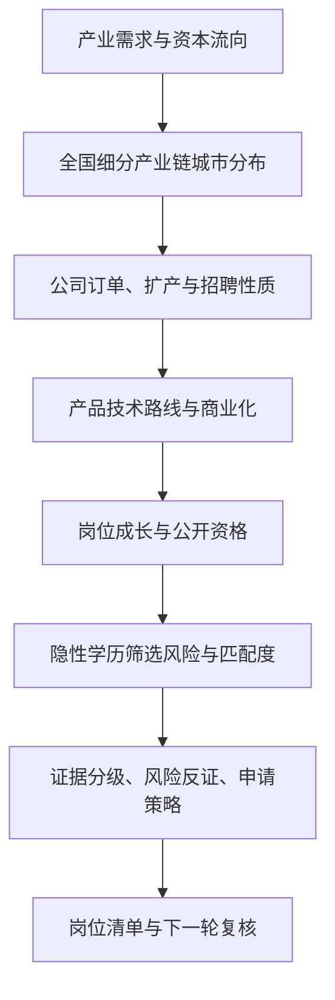

# Industry Momentum Job Screening

> **产业趋势驱动的求职筛选 Skill** — Follow capital flows, verify business expansion, identify emerging products, and assess real hiring accessibility before applying.

一个面向中国校招及职业早期岗位的、**以证据为核心的研究型 AI Skill**。它不是招聘信息聚合器，也不是一份静态热门公司榜单，而是一套从产业趋势逐层穿透到具体岗位的可复用调研流程。

## 解决什么问题？

传统求职筛选常常只看公司名气、薪资或 JD 的表面要求。本项目希望回答五个更难的问题：

1. **行业是否真的向上？** 产业基金、龙头企业资本开支、订单和终端需求能否相互验证？
2. **产业链的核心城市在哪里？** 对每条细分产业链，先用可比规模排城市，再看配套完整度与机会，**不预设地域偏好**。
3. **公司为什么招人？** 是扩产、新业务团队，还是补充人员？有多少证据能支持这个判断？
4. **产品有没有势？** 是技术发布、客户验证、小批量交付还是规模化商业化？
5. **我有现实录用机会吗？** 区分公开 JD 硬条件、可能存在的隐性学校偏好、技能差距和招聘竞争强度。

## 工作流



## 特色能力

| 模块 | 研究要点 | 输出 |
| --- | --- | --- |
| 行业势 | 产业资本、资本开支、下游需求、招标订单 | 产业机会及反证 |
| 城市排序 | **细分产业链规模优先**，完整度与岗位机会次之 | 各赛道独立城市榜 |
| 公司势 | 新建项目、招聘时间序列、财报与现金流 | 扩张 A/B、补充 C、未知 D、风险 E |
| 产品势 | 技术路线、客户验证、交付阶段、商业化 | 新老产品及阶段判断 |
| 岗位势 | 核心业务关联、成长路径、可迁移技能 | 岗位价值与能力差距 |
| 录用可行性 | 公开要求与同岗往届样本分离 | 学历证据 H0—H4，申请优先级 |
| 证据链 | 来源、日期、统计口径、反证、可信度 | 可追溯结论而非印象打分 |

**扩张类型 A—E**：A=官方确认新增编制/扩张；B=多源高可信扩张推断；C=确认的人员补充；D=未知；E=有证据支持的招聘/经营风险。

**学历筛选 H0—H4**：H0=证据不足；H1=存在同背景录用反证；H2=有学校偏好迹象；H3=多项同岗证据指向较高筛选风险；H4=明确不符合官方客观必要资格。**这些标签不是录用概率；普通院校背景不能被自动判为 H4。**

## 快速开始

此仓库是一个由 `SKILL.md` 和参考文件组成的**指令型 Skill**；它不包含爬虫、自动申请脚本，也不会凭空产生实时岗位数据。使用时需要能够检索网页的 AI 助手或人工提供来源；若需要持续监控，还需在宿主工具中配置定时任务。

1. 克隆或下载本仓库。
2. 将整个目录放入所用 AI 助手支持的 Skills 目录，或把 `SKILL.md` 与 `references/` 文件加入该助手的工作上下文；不同客户端的安装/发现方式可能不同。
3. 提供目标行业、校招届别、真实学历与经历、技能、薪酬和工作方式限制（这些信息**不需要提交到 GitHub**）。
4. 让助手按 Skill 工作流搜索、核实、分类并产出带来源的决策报告。

### 示例提示词

```text
请使用 industry-momentum-job-screening Skill，为下一届中国校招生筛选半导体设备工程师岗位。
先绘制前道设备制造细分产业链，按可比产业规模排序全国核心城市；
再分析扩产和订单验证、产品商业化阶段、招聘是否新增编制；
最后核实官方JD、同岗近两届录用证据、可能的隐性学历筛选风险、专业技能差距和申请入口。
请输出产业链城市榜、企业池、岗位池、反证、证据可信度和投递策略。
未证实的结论明确标记“待核实”，不要虚构招聘信息和录用概率。
```

## 输出示例（虚构结构，非实际招聘结果）

| 城市层级 | 企业 | 产品阶段 | 招聘性质 | 学历风险 | 建议 |
| --- | --- | --- | --- | --- | --- |
| 1（待证实） | A公司 | 客户验证 | B（高可信推断） | H0（未知） | 补充同岗证据后申请 |
| 2（待证实） | B公司 | 规模交付 | D（未知） | H1（有同背景案例） | 优先核实官方JD |

不得将上述虚构示例当作城市排名、企业招聘或真实录用统计。

## 仓库结构

```text
industry-momentum-job-screening/
├── SKILL.md                          # 主 Skill：完整调研工作流与质量控制
├── references/
│   ├── city-ranking-method.md       # 全国细分产业链城市排序
│   ├── hidden-education-screening.md # 岗位级隐性学历筛选证据框架
│   ├── research-checklist.md        # 检索词、来源优先级、HR访谈问题
│   └── schema.md                    # 城市池、公司池、岗位池、证据日志字段
├── examples/
│   └── report-outline.md            # 空白研究报告结构和虚构样例
├── CONTRIBUTING.md
└── README.md
```

## 使用边界与隐私

- 不把**投资热度**等同于产业需求，不把**融资**等同于营收，不把**重复岗位**等同于高人员流失。
- 真实公司与岗位必须附原始来源、发布日期/检索日期。招聘状态和录用证据会变化，应复核。
- 同公司的研究算法岗与工厂设备岗不能共享一份“隐性学历门槛”结论。
- 只使用公开、获授权的合法信息；不收集或发布候选人私人简历、offer截图、联系方式和未经许可的人事信息。
- 评分只用于比较候选机会，**不能解释为客观招聘录用概率**。
- 不自动发送简历、不提供虚构的公司或岗位数据。

## 适用领域

半导体设备、晶圆制造、先进封装、工业自动化、机器人及具身智能、关键零部件等。方法也可适配其他有明确产业链结构的技术行业。

## English summary

**Industry Momentum Job Screening** is an evidence-first AI skill for evaluating early-career opportunities in Chinese industrial sectors. It connects investment flows, city-level supply-chain concentration, company hiring expansion, product commercialization, position-specific skill growth, and observed education-screening risks. It prioritizes verifiable sources and avoids fabricated hiring probabilities. This repository contains research instructions and templates, not an automated job crawler.

## Status & license

Research workflow and documentation only; no live data feed or scraping pipeline included. No open-source license has been selected yet; public visibility alone does **not** grant reuse permissions beyond applicable law. Repository owner can choose a license before accepting third-party contributions.